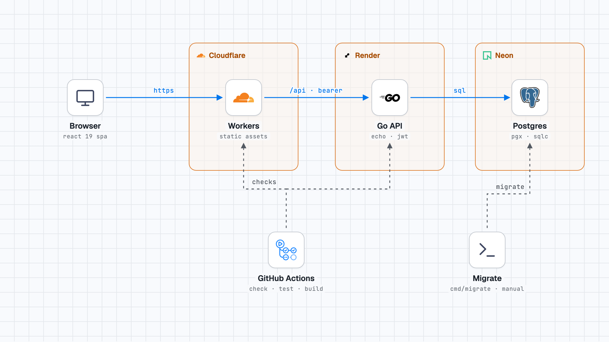

# go-next

A shop API where everything is paid in coins — one coin is one dollar, rounded up — and the part
worth reading is checkout. Two people buying the last unit at the same moment cannot both succeed,
and neither the stock nor the balance can end up wrong.

- Frontend: <https://frontend.kawabata-qppq.workers.dev>
- API: <https://go-next-f5yi.onrender.com/healthz>
- Demo account: `demo@go-next.dev` / `go-next-demo` — shared on purpose, the password is public

The API runs on Render's free tier, so it sleeps after fifteen minutes and the first request takes
twenty to twenty-five seconds. The UI says so after three instead of spinning silently.



## What it does

- **Browse** twenty products in three categories, with keyword search and a category filter.
- **Cart** stored on the server, so it survives a reload and follows the account.
- **Checkout** in coins: the server computes the total from stored prices, never from the request.
- **History** of past orders, each with the line items and the price it was bought at.
- **Account** with the balance, the ledger that explains it, and a demo top-up.

## How checkout stays correct

One transaction, in this order:

1. Lock the user row, then the product rows in ascending id. A fixed order is what stops two
   checkouts from deadlocking each other.
2. Check the stock and the balance inside the lock, not before it.
3. Write the order and its lines, decrement the stock, debit the coins, append the ledger row.
4. Clear the cart in the same transaction.

If anything fails — `409 insufficient stock` or `402 insufficient coins` — nothing is written and
the cart is left alone.

`TestCheckout_ConcurrentLastUnit` starts two checkouts against a product with one unit left and
asserts the outcome rather than the timing: one order, one `insufficient stock`, stock at zero,
exactly one ledger row, and the coins debited once.

## Decisions

Each one is written up as an issue, with the alternatives that were rejected.

| Topic | Issue |
| --- | --- |
| One transaction and two locks | [#43](https://github.com/un-null/go-next/issues/43) |
| Ties, ordering and search in SQL | [#44](https://github.com/un-null/go-next/issues/44) |
| Tokens in sessionStorage, not cookies | [#45](https://github.com/un-null/go-next/issues/45) |
| Server state (TanStack Query) vs form state (`useActionState`) | [#46](https://github.com/un-null/go-next/issues/46) |
| A Vite SPA instead of Next.js | [#47](https://github.com/un-null/go-next/issues/47) |
| Deploying on free tiers | [#48](https://github.com/un-null/go-next/issues/48) |
| CI and the checks that gate a merge | [#49](https://github.com/un-null/go-next/issues/49) |
| What the tests do and do not cover | [#50](https://github.com/un-null/go-next/issues/50) |

## Stack

Go 1.23 · Echo · pgx · sqlc · PostgreSQL 16 (Neon) on Render, behind a React 19 SPA (Vite,
Mantine, TanStack Query, React Router) served as static assets by Cloudflare Workers. GitHub
Actions runs both test suites.

## Layout

```
backend/     Go API, migrations, README
frontend/    React SPA, README
docs/        the diagram above
```

## Running it

- API: [`backend/README.md`](backend/README.md) — environment, endpoints, tests, migrations
- SPA: [`frontend/README.md`](frontend/README.md) — dev server, checks, deploy

Coins are demo currency with no monetary value, and there is no payment, address or admin behind
them.
